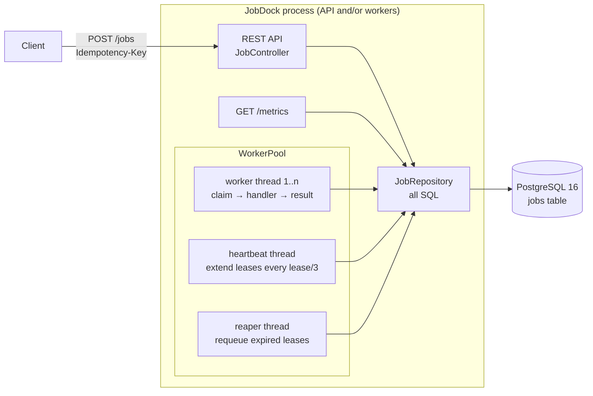

# JobDock

A durable background job queue on PostgreSQL — Java 21, Spring Boot 3.5, plain SQL
(`JdbcClient`), Flyway, Testcontainers.

## The problem

Background jobs are easy until a worker crashes, a handler throws, or two workers
poll at the same time. JobDock is a small, tested answer to three questions:

1. **Can two workers take the same job?** No — claims use
   `SELECT ... FOR UPDATE SKIP LOCKED`, and only the current claim can record a result.
2. **What happens when a handler fails?** Retry with exponential backoff and jitter,
   then dead-letter (`DEAD`) after `maxAttempts`, keeping the last error.
3. **What happens when a worker dies mid-job?** Its lease stops being renewed; a
   reaper requeues the job and another worker runs it.

It is deliberately *at-least-once*, and says exactly when a handler can run twice
(see [Guarantees](#guarantees-and-non-guarantees)).

## Architecture



All queue state is one `jobs` table; every state change is a single SQL statement
guarded by the expected state. Any number of processes can run the API, workers,
or both against the same database — correctness never depends on in-process state.

```
             enqueue
                |
                v
   +-------> QUEUED ----claim----> RUNNING ----success----> SUCCEEDED
   |                                 |   |
   | retry time reached              |   +-- lease expired (reaper) --> FAILED_RETRY, or DEAD
   |                                 |
   +---- FAILED_RETRY <--failure-----+   (attempts < maxAttempts)
                                     |
                                     +-- failure, attempts used up --> DEAD (lastError kept)
```

Key mechanisms (full detail in [docs/DESIGN.md](docs/DESIGN.md)):

| Mechanism | How |
|-----------|-----|
| Claim | one CTE + `UPDATE`: `FOR UPDATE SKIP LOCKED`, sets `RUNNING`, owner, `attempts + 1`, `locked_until = now() + lease` |
| Fencing | success, failure and heartbeat updates require `status = RUNNING AND locked_by = :worker AND attempts = :attempt` |
| Heartbeat | one thread per pool extends all held claims (running job + unstarted rest of the batch) every lease/3 |
| Reaper | expired `RUNNING` leases → `FAILED_RETRY` (due now) or `DEAD`; `SKIP LOCKED`, safe on many instances |
| Backoff | `min(base · 2^(n-1), max) · (0.5 + 0.5r)`, applied with the **database** clock |
| Idempotent enqueue | `INSERT ... ON CONFLICT (idempotency_key) DO NOTHING`; replay → 200, key misuse → 409 |

## Guarantees and non-guarantees

**Guaranteed** (each backed by an integration test against real PostgreSQL):
- A committed enqueue is never lost; one `Idempotency-Key` creates at most one job,
  also under concurrent requests.
- A job has at most one *current* claim. With no crashes, each job's handler ran
  exactly once in the concurrency tests (8 workers × 1000 jobs; 2 pools with
  concurrent producers).
- Only the current claim can record a result or extend the lease — a worker whose
  lease was taken away cannot overwrite the new owner's result.
- A failing job is retried with backoff and ends `DEAD` after `maxAttempts`.
- A job held by a dead worker is recovered after its lease expires, and each
  expired lease is requeued once even with many concurrent reapers.

**Not guaranteed — a handler can run more than once:**
1. The worker dies after the handler's side effect but before the result is written.
2. A live worker stops heartbeating for a whole lease period (long GC pause,
   network partition). The job is reclaimed while the first handler may still be
   running — two handlers can **overlap in time**; fencing only discards the stale result.
3. A retry after a failure that happened after a side effect.

So **handlers must be idempotent** (e.g. use the job id as a deduplication key).
Exactly-once is not claimed. Also not provided: ordering (FIFO is best-effort),
priorities, cancellation, per-type concurrency limits, cleanup of finished jobs.

## Run it

### Tests

Requires Java 21 and a running Docker daemon (Testcontainers starts PostgreSQL 16).

```bash
./mvnw verify
```

Latest local run (`./mvnw clean verify`, the run that produced this README):
**44 unit tests and 61 integration tests, 0 failures, 0 skipped.** CI runs the same
command on GitHub Actions.

Notable tests: `ConcurrentWorkersIT`, `RetryConcurrencyIT` (no job on two workers
at once while retrying), `CrashRecoveryIT` (a worker in a **separate JVM is killed
with `kill -9`** mid-job, another worker recovers and completes the job),
`ZombieWorkerIT`, `HeartbeatIT`, `LeaseReaperIT` (8 concurrent reapers),
`ResultWriteFailureIT`. Each core mechanism was also mutation-checked: removing it
makes a test fail (list in [docs/TASKS.md](docs/TASKS.md)).

### Crash demo with Docker Compose

Requires Docker with Compose v2, `curl`, `jq` and Java 21.

```bash
./scripts/crash-demo.sh
```

It builds the jar, starts `postgres:16.16-alpine3.24`, one API instance (no workers)
and two worker containers (demo lease 6s, reaper every 2s), enqueues a `demo.sleep`
job that runs for 20s, `docker kill`s the worker container holding it, and follows
the job. Output of one run (trimmed):

```
RUNNING, attempt 1, owner 274df5e620c0-1-7f31aaaa-0 (container 274df5e620c0)
killed 274df5e620c0; status in the database is still: RUNNING (lease not expired yet)
13:37:06 RUNNING attempt=1 owner=274df5e620c0-1-7f31aaaa-0
13:37:13 FAILED_RETRY attempt=1 owner=null
13:37:14 RUNNING attempt=2 owner=b2e8dc3ce056-1-1fdcc10f-0
13:37:33 SUCCEEDED attempt=2 owner=null
"lastError": "Lease expired: worker 274df5e620c0-1-7f31aaaa-0 stopped heartbeating during attempt 1"
```

Recovery time is configuration, not performance: roughly lease duration + reaper
interval + poll delay. Clean up with `docker compose down -v`.

Manual steps instead of the script:

```bash
./mvnw -B -DskipTests package && docker compose up -d --build --wait
```

```bash
curl -s -X POST localhost:8080/jobs -H 'Content-Type: application/json' \
  -d '{"type":"demo.sleep","payload":{"seconds":20}}'
```

```bash
docker compose logs -f worker
```

Then `docker kill` the worker container that logged `started`, and poll
`GET localhost:8080/jobs/{id}`.

### Standalone

```bash
./mvnw -B -DskipTests package
```

```bash
JOBDOCK_DB_URL=jdbc:postgresql://localhost:5432/jobdock JOBDOCK_DB_USER=jobdock \
JOBDOCK_DB_PASSWORD=... JOBDOCK_DEMO_ENABLED=true java -jar target/jobdock.jar
```

Flyway creates the schema on startup. Register your own handlers by implementing
`com.jobdock.worker.JobHandler` as a Spring bean (one per job `type`).

## API

`POST /jobs` — body `{"type": "...", "payload": {...}, "runAt": optional ISO-8601,
"maxAttempts": optional 1–100 (default 5)}`, optional header `Idempotency-Key`.

| Response | When |
|----------|------|
| `201 Created` + `Location` | new job |
| `200 OK` + `Idempotent-Replayed: true` | same key, same `type` and `payload`: original job returned |
| `409 Conflict` | same key reused with a different `type` or `payload` |
| `400 Bad Request` | invalid body or header |

`GET /jobs/{id}` — the job (status, attempts, lastError, lease, timestamps) or `404`.

`GET /metrics` — one aggregate query over the jobs table:

```json
{"countsByStatus":{"QUEUED":0,"RUNNING":0,"SUCCEEDED":1,"FAILED_RETRY":0,"DEAD":1},
 "oldestDueAgeSeconds":null,"retriesTotal":1,"deadLettered":1,"leaseExpirationsTotal":0}
```

`oldestDueAgeSeconds` is how long the longest-waiting *claimable* job has been due;
`retriesTotal` is `sum(attempts - 1)`; definitions in DESIGN.md section 6a.

## Configuration

| Property | Default | Meaning |
|----------|---------|---------|
| `jobdock.worker.enabled` | `true` | run workers in this process |
| `jobdock.worker.threads` | `4` | worker threads (each claims independently) |
| `jobdock.worker.batch-size` | `10` | jobs claimed per poll |
| `jobdock.worker.idle-delay` | `500ms` | sleep when nothing was claimed |
| `jobdock.worker.lease-duration` | `30s` | visibility timeout; heartbeat every lease/3 |
| `jobdock.worker.reaper-interval` | `5s` | how often expired leases are recovered |
| `jobdock.worker.shutdown-timeout` | `30s` | wait for in-flight jobs on shutdown |
| `jobdock.retry.base-delay` / `max-delay` | `1s` / `5m` | backoff |
| `jobdock.demo.enabled` | `false` | register the `demo.sleep` handler |

## Design trade-offs

- **Postgres as the queue.** No extra infrastructure, durable, transactional,
  inspectable with SQL. Cost: workers poll (latency up to `idle-delay`), and a
  high-churn table needs vacuum attention. A broker would scale further; this
  project's goal was correctness that can be demonstrated, not throughput.
- **Leases instead of long transactions.** Row locks are held only for the claim
  statement, so a slow handler never blocks the table — at the price of the overlap
  case above. Lease length trades crash-recovery time against reclaiming slow-but-alive workers.
- **Attempt number as the fencing token.** Cheap (no extra column) and also rejects a
  stale claim when the same worker id gets the job back later.
- **Reaped jobs retry immediately**, without backoff, since the usual cause is a dead
  worker. A job that keeps crashing workers still ends `DEAD`, because every
  attempt counts.
- **Database clock everywhere** (`now()` for claim, retry time, lease, reaper), so
  app-server clock skew does not matter.
- **Metrics from a full-table aggregate.** Simple and consistent across instances;
  would not scale to very large tables.

## What I would do next

- Test a full database outage (e.g. with Toxiproxy): only a failed result write
  is tested today.
- Measure throughput and recovery latency with a load test, and publish numbers
  only together with the method used.
- `LISTEN/NOTIFY` to wake idle workers instead of polling.
- Retention: archive or delete finished jobs; partition the table.
- Micrometer/Prometheus metrics, and a CI job that runs the compose crash demo.
- Optionally interrupt a handler whose lease was lost; offer a helper to enqueue
  inside the caller's own transaction (outbox style).

## Docs

- [docs/DESIGN.md](docs/DESIGN.md) — state machine, schema, protocols, delivery semantics, failure scenarios.
- [docs/TASKS.md](docs/TASKS.md) — task log per batch, including the mutation checks.

Out of scope by design: UI, auth, multi-tenancy, external brokers, cloud deployment.
